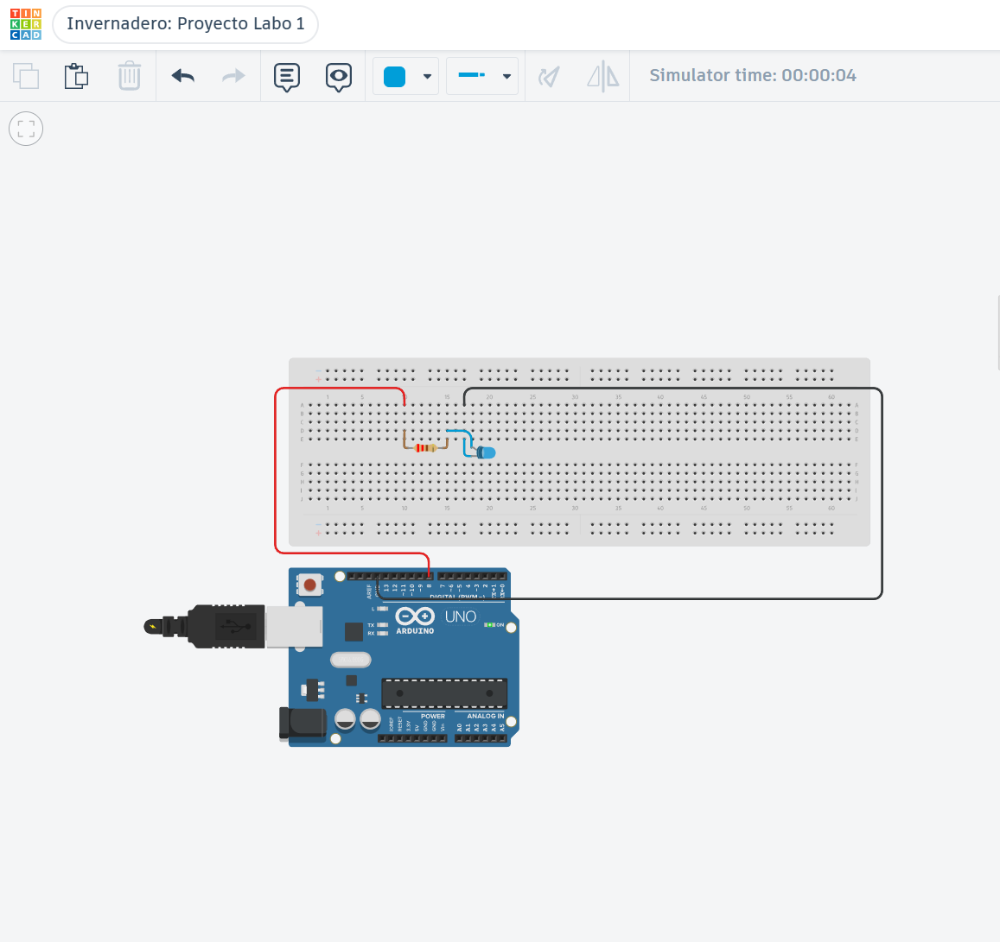
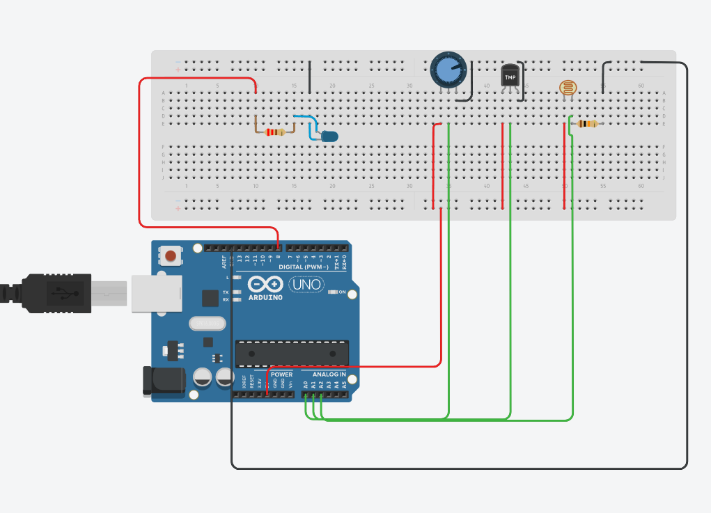

# Evolución de la simulación

Este documento registra la evolución del circuito desarrollado en Tinkercad.

Cada versión debe incluir una captura del circuito, una descripción de los cambios, las conexiones incorporadas, las pruebas realizadas y cualquier problema conocido.

## Simulación actual

Enlace de Tinkercad:

[Abrir la simulación en Tinkercad](https://www.tinkercad.com/things/3ApQIPepXQz-invernadero-proyecto-labo-1/editel?returnTo=https%3A%2F%2Fwww.tinkercad.com%2Fdashboard&sharecode=7U7pwsu07O8A8DXGv41fDI6yS_DnJD5i0dr5DXYXfiE)

Versión actual:

> `v0.2.0` — Lectura de sensores funcional.

## Convención para las imágenes

Las capturas se guardan en `docs/images/` utilizando este formato:

```text
tinkercad-v0.1.0.png
tinkercad-v0.2.0.png
tinkercad-v0.3.0.png
```

Para insertar una captura:

```md

```

## Historial del circuito

### `v0.1.0` — Circuito inicial

**Objetivo:** comprobar el funcionamiento básico del Arduino y la estructura inicial del circuito.

**Cambios realizados:**

- Se agregó el Arduino Uno.
- Se agregó la breadboard.
- Se conectó un LED azul al pin digital 8 mediante una resistencia de 220 Ω.
- Se programó un parpadeo de un segundo para comprobar la salida digital.

**Circuito:**


**Conexiones incorporadas:**

| Origen | Destino | Función |
|---|---|---|
| Pin digital 8 | Resistencia de 220 Ω | Salida controlada por Arduino |
| Resistencia de 220 Ω | Ánodo del LED azul | Limitación de corriente |
| Cátodo del LED azul | GND | Cierre del circuito |

**Pruebas realizadas:**

| Prueba | Resultado |
|---|---|
| La simulación inicia correctamente | Correcto |
| El código compila sin errores | Correcto |
| El LED responde correctamente | Correcto: enciende y apaga cada segundo |

**Problemas conocidos:**

- Ninguno conocido.

---

### `v0.2.0` — Lectura de sensores

**Objetivo:** leer la humedad simulada, la temperatura y la iluminación ambiental.

**Cambios realizados:**

- Se agregó un potenciómetro para simular la humedad de la tierra.
- Se agregó un TMP36 para medir la temperatura.
- Se agregó una fotoresistencia con un divisor de tensión de 10 kΩ.
- Se incorporó la lectura de `A0`, `A1` y `A2`.
- Se convirtieron humedad e iluminación a porcentajes y la temperatura a grados Celsius.
- Se mostraron las tres mediciones mediante el monitor serie.

**Circuito:**



**Conexiones agregadas:**

| Componente | Pin del componente | Conexión |
|---|---|---|
| Potenciómetro de humedad | Cursor central | `A0` |
| TMP36 | `VOUT`, pata central | `A1` |
| Fotoresistencia | Unión con resistencia de 10 kΩ | `A2` |
| Sensores | Alimentación | 5 V y GND compartidos |

**Pruebas realizadas:**

| Prueba | Resultado |
|---|---|
| Lectura de humedad | Correcto: porcentaje variable |
| Lectura de temperatura | Correcto: conversión a grados Celsius |
| Lectura de iluminación | Correcto: porcentaje variable |
| Visualización en monitor serie | Correcto: tres mediciones visibles |
| Funcionamiento del LED azul | Correcto: conserva el parpadeo |

**Problemas conocidos:**

- Ninguno conocido. Durante el montaje se corrigió una conexión incorrecta de GND en el divisor de la fotoresistencia.

---

## Plantilla para una nueva versión

Copiar esta sección por cada actualización importante:

```md
### `vX.Y.Z` — Nombre de la versión

**Objetivo:**

Descripción breve del objetivo de la versión.

**Cambios realizados:**

- Cambio 1.
- Cambio 2.
- Cambio 3.

**Circuito:**


**Conexiones agregadas o modificadas:**

| Componente | Pin del componente | Conexión |
|---|---|---|
| Componente | Pin | Destino |

**Pruebas realizadas:**

| Prueba | Resultado |
|---|---|
| Descripción de la prueba | Correcto/Pendiente/Error |

**Problemas conocidos:**

- Descripción del problema o “Ninguno”.
```

## Criterio de actualización

Este documento debe actualizarse cuando:

- Se agregue o elimine un componente.
- Cambie una conexión.
- Se incorpore una funcionalidad.
- Se corrija un problema de cableado.
- Se complete un nuevo hito del roadmap.

No es necesario crear una captura por cada commit. Una captura por cada versión funcional es suficiente.
